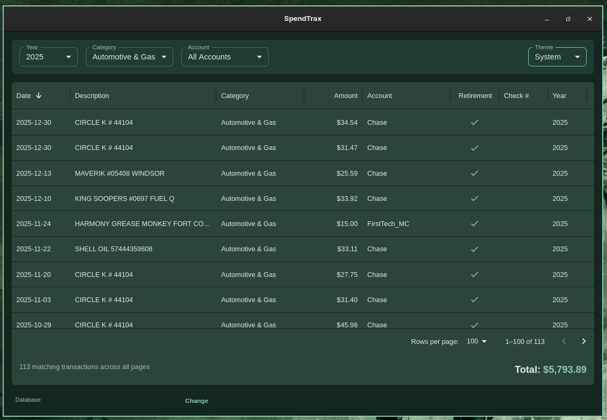

# SpendTrax

SpendTrax is a local desktop application for viewing and editing transactions in an existing SpendTrax SQLite database. It uses Tauri 2 and Rust for database access, with React, TypeScript, and MUI Data Grid for the interface.



## Features

- Filter transactions by year, category, and account, or use the grid's column filters.
- Sort and browse records in pages of 25, 50, or 100 rows.
- Edit dates, descriptions, categories, amounts, accounts, retirement flags, and check numbers.
- Review pending edits, then save them together or discard them.
- See the count and USD total of all matching transactions across all pages. Zero matches displays a zero total.
- Choose a Light, Dark, or System theme using the Theme selector beside the filters. On Omarchy, System follows the active desktop color palette. On other systems, it follows the operating system's light/dark preference. Your choice is saved locally between sessions.

The app currently edits existing records. It does not import bank files, create transactions, or create databases through the interface. Amounts are displayed as USD; currency conversion is not supported.

## Development setup

Install:

- Node.js 22.12 or newer and Yarn Classic (1.x).
- Rust and Cargo using a current stable toolchain.
- The platform-specific [Tauri 2 prerequisites](https://v2.tauri.app/start/prerequisites/) for your operating system, including the native compiler and webview libraries.
- SQLite's command-line tool if you want to create the sample database below.

From the project directory:

```sh
yarn install --frozen-lockfile
yarn tauri dev
```

`yarn tauri dev` starts the frontend server and the desktop application. `yarn dev` starts only the frontend; database commands and native file dialogs require the Tauri application.

### Development troubleshooting

If Tauri reports mismatched JavaScript and Rust versions after a dependency change, run `yarn install` to synchronize `node_modules` and `yarn.lock` with `package.json`, then retry `yarn tauri dev`. Commit the updated lockfile with the manifests. Use `--frozen-lockfile` for subsequent installs once the lockfile is synchronized.

The JavaScript API and Rust core must share a major/minor version; plugin versions should match exactly. The runtime dependencies are pinned in both manifests so they can be updated together. See [Tauri's dependency update guidance](https://v2.tauri.app/develop/updating-dependencies/#sync-npm-packages-and-cargo-crates-versions).

If a build reports missing generated permission files at an old project path after moving the project, stop the development server and clear the Rust build cache:

```sh
cargo clean --manifest-path src-tauri/Cargo.toml
yarn tauri dev
```

This removes generated Rust build artifacts, not your source code or database. The next build will take longer.

## Try it with fictional data

The SQL files in `examples/` contain the schema and three entirely fictional transactions. Create a **new** database with SQLite:

```sh
sqlite3 demo.db ".read examples/schema.sql"
sqlite3 demo.db ".read examples/demo.sql"
```

Launch the application and choose `demo.db` using **Select Database File**. The resulting database is excluded from Git. These commands also work in PowerShell when SQLite is installed and available on your PATH.

To create an empty compatible database, run only the schema command. Populate it using your own import tooling; the UI does not provide an add-record form. Do not run the sample commands against your personal database.

## Use your own database

Back up your database before editing it. Select a `.db`, `.sqlite`, or `.sqlite3` file with a compatible `transactions` table; [examples/schema.sql](examples/schema.sql) defines the required layout. Dates must use `YYYY-MM-DD`, `year` must correspond to the date, and `retirement` uses SQLite boolean values `0` and `1`.

The app remembers the selected database path in `db_path.txt` in its per-user configuration directory, resolved using the `directories` Rust crate. On Linux this is normally `$XDG_CONFIG_HOME/spendtrax-ui`, or `~/.config/spendtrax-ui` when that variable is unset. If no saved database exists, it looks for `spendtrax.db` beside the executable and otherwise asks you to select a file. A database in the source directory is not automatically found beside the development executable.

Double-click an editable cell, make your change, and press Enter to finish editing (Escape cancels the active cell edit). **Save Changes** writes the pending edits in one database transaction. **Discard** reloads the database. Dates are validated in the UI and again in Rust, and changing a date updates its year.

Finish the active cell edit, then save or discard pending changes before selecting **Change** to switch databases. Saves are checked against the database they originated from. Closing the app without saving loses pending edits; there is no close confirmation or undo after a successful save.

The category and account editors offer values already present in the selected database.

## Build and checks

```sh
yarn build
cargo fmt --manifest-path src-tauri/Cargo.toml -- --check
cargo check --manifest-path src-tauri/Cargo.toml --locked
cargo test --manifest-path src-tauri/Cargo.toml --locked
```

The Rust tests use an in-memory database populated from the fictional SQL examples. They cover date validation, save guards, and rollback of invalid batches.

To build a desktop release for the current platform:

```sh
yarn tauri build
```

Build artifacts are written beneath `src-tauri/target/release/`; packaged installers appear in its `bundle/` directory. Platform packaging and signing may require additional setup. Linux compilation has been checked locally; Windows/macOS packages have not been verified.

## Data and repository privacy

Application database operations run locally. The application code does not implement cloud sync, analytics, or transaction uploads. SQLite data and the saved database path are not encrypted by this application.

The theme preference is stored in the webview's local storage, separately from the transaction database. On Linux, System reads Omarchy's `~/.local/state/omarchy/current/theme/colors.toml` (with the older config-directory location as a fallback). It checks for changes every two seconds while visible and when the app regains focus. Only validated color values are passed to the UI; no desktop configuration is modified. Missing or invalid palettes fall back to ordinary system light/dark mode. Explicit Light and Dark selections keep SpendTrax's built-in palettes.

Developers can customize the palette mapping and shared component styling in `src/theme.ts`.

The root `.gitignore` excludes databases and SQLite sidecars, database archives/backups, CSV exports, local environment files, signing keys, dependencies, and generated builds. Keep real transaction data out of SQL fixtures, screenshots, documentation, and issue reports. Only the synthetic SQL examples should be committed.

Before the first commit, inspect `git status --short` and `git diff --cached`. Ignore rules do not protect files deliberately force-added to Git.

## License

Licensed under the [MIT License](LICENSE). Copyright (c) 2026 jeffl.

Third-party dependencies remain subject to their respective licenses.
